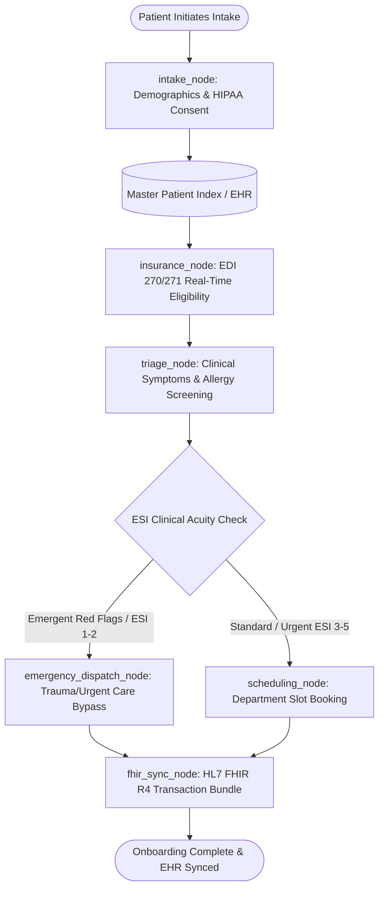

# 🏥 Hospital Patient Onboarding System (Google ADK 2.0)
## Enterprise Architecture & Technical Specification

An end-to-end, clinical-grade patient intake and onboarding system built using the **Google Agent Development Kit (ADK 2.0)**. It automates patient registration, real-time insurance verification, Emergency Severity Index (ESI) clinical triage, specialty scheduling, and HL7 FHIR R4 EHR ingestion while guaranteeing strict HIPAA compliance and patient safety.

---

### Project Structure
```
patient_onboarding_adk/
```

---

## 1. System Architecture & Workflow Graph



---

## 2. Core Capabilities Implementation Matrix

| Capability Pillar | Implementation Module | ADK Feature Utilized | Healthcare / Clinical Value |
| :--- | :--- | :--- | :--- |
| **Tool & Interface Design** | `src/tools/` & `src/interfaces/` | `FunctionTool`, Pydantic validation, HITL Confirmation Guardrails | Real-time EDI 270/271 eligibility, Master Patient Index lookup, No Surprises Act cost estimates, CLI runner & FastAPI service. |
| **Context & Memory** | `src/memory/` | `SessionService`, `State` (`session`, `user:`, `app:`, `temp:`) | Multi-scope memory: longitudinal clinical records persist across hospital visits, while raw temporary tokens are scrubbed to prevent PHI leaks. |
| **Orchestration & Logic** | `src/agents/` & `src/workflow/` | ADK `Workflow`, `START`, `DEFAULT_ROUTE`, Multi-Agent Hierarchy | Deterministic triage routing: acute red flags (chest pain, stroke signs) bypass standard queues to emergency beds immediately. |
| **Observability & Tracing** | `src/observability/` | `AutoTracingPlugin`, OpenTelemetry SDK, HIPAA PHI Sanitizer | Automated OpenTelemetry distributed tracing, immutable audit logs compliant with HIPAA 164.312(b), and funnel KPI metrics. |
| **Infrastructure & CI/CD** | `infra/` & `.github/workflows/` | Multi-stage Dockerfile, Cloud Run, Terraform IaC, GitHub Actions, Cloud Build | Hardened non-root runtime, private VPC EHR connectivity, automated vulnerability scanning, and golden dataset evals. |

---

## 3. Directory Layout

```
patient_onboarding_adk/
├── README.md                                  # Complete developer and operator guide
├── pyproject.toml                             # Packaging, Ruff, Pytest, and MyPy configuration
├── requirements.txt                           # Core runtime and test dependencies
├── .env.example                               # Environment template for Gemini & GCP
│
├── config/                                    # Hospital configurations & settings
│   ├── settings.py                            # Pydantic BaseSettings
│   └── hospital_departments.json              # Clinical specialties, physicians, and consultation slots
│
├── src/
│   ├── models/                                # Pydantic domain models
│   │   ├── patient.py                         # Demographics, Emergency Contacts, HIPAA Consent
│   │   ├── insurance.py                       # Insurance Policy, Eligibility, Coverage Details
│   │   ├── clinical.py                        # ESI Acuity (1-5), Allergies, Medications
│   │   ├── appointment.py                     # Clinic Departments, Booking Confirmations
│   │   └── fhir.py                            # HL7 FHIR R4 Bundle schemas
│   │
│   ├── tools/                                 # 1. Tool & Interface Design
│   │   ├── identity_tools.py                  # MPI lookup and demographic verification
│   │   ├── insurance_tools.py                 # Real-time EDI 270/271 benefits and cost estimates
│   │   ├── clinical_tools.py                  # ESI triage scoring and drug-allergy contraindication checks
│   │   ├── scheduling_tools.py                # Department slot lookup and reservation
│   │   ├── fhir_tools.py                      # Atomic HL7 FHIR R4 Transaction Bundle export
│   │   └── confirmation_guard.py              # Human-in-the-Loop guardrails
│   │
│   ├── memory/                                # 2. Context & Memory
│   │   ├── state_manager.py                   # Multi-scope state manager (session, user:, app:, temp:)
│   │   ├── session_service.py                 # Pluggable session service (Memory/SQLite/Firestore)
│   │   └── clinical_memory.py                 # Longitudinal episodic patient history store
│   │
│   ├── agents/                                # 3. Orchestration & Logic
│   │   ├── coordinator.py                     # Root Onboarding Coordinator Agent
│   │   ├── intake_agent.py                    # Demographics & HIPAA Agent
│   │   ├── insurance_agent.py                 # Insurance Verification & Copay Agent
│   │   ├── triage_agent.py                    # Clinical Triage Nurse Agent
│   │   └── scheduling_agent.py                # Department Logistics & Scheduling Agent
│   │
│   ├── workflow/                              # Graph-based Workflow
│   │   ├── onboarding_workflow.py             # ADK Workflow graph with conditional branching
│   │   └── routes.py                          # Routing condition constants
│   │
│   ├── observability/                         # 4. Observability & Tracing
│   │   ├── tracer.py                          # OpenTelemetry tracing & ADK AutoTracingPlugin
│   │   ├── hipaa_sanitizer.py                 # Real-time PII/PHI redaction filter
│   │   ├── audit_logger.py                    # Immutable HIPAA clinical audit logging
│   │   └── metrics.py                         # Intake funnel KPI metrics tracker
│   │
│   └── interfaces/                            # Interfaces
│       ├── cli_runner.py                      # Interactive terminal CLI runner
│       └── api_server.py                      # FastAPI REST and WebSocket service
│
├── tests/                                     # Automated Test Suite
│   ├── conftest.py                            # Fixtures and test patient payloads
│   ├── test_tools.py                          # Tool validation tests
│   ├── test_memory.py                         # State scoping and persistence tests
│   ├── test_workflow.py                       # Integration tests for graph execution
│   ├── test_observability.py                  # HIPAA sanitization and metrics tests
│   └── test_evaluation.py                     # Evalset golden benchmark runner
│
├── evals/                                     # Evaluation Benchmarks
│   ├── evalset.json                           # Golden clinical test cases
│   └── eval_criteria.json                     # Evaluation rubric (Safety, Completeness, Empathy)
│
└── infra/                                     # 5. Infrastructure & CI/CD
    ├── Dockerfile                             # Multi-stage secure non-root Docker build
    ├── docker-compose.yml                     # Local stack with HAPI FHIR and Jaeger
    ├── cloudrun-service.yaml                  # Google Cloud Run production manifest
    ├── cloudbuild.yaml                        # Google Cloud Build pipeline
    └── terraform/                             # GCP Infrastructure as Code
        ├── main.tf
        ├── variables.tf
        └── outputs.tf
```

---

## 4. Key Highlights & Safety Mechanisms

> [!IMPORTANT]
> **Deterministic Triage Safety Net**: Unlike pure LLM chat implementations, patient safety decisions are deterministically enforced via graph edges. Symptoms triggering myocardial infarction, stroke, or anaphylaxis patterns immediately bypass all non-urgent steps and route to Emergency Care.

> [!NOTE]
> **HIPAA Compliance by Design**:
> - All outbound trace attributes, log records, and error messages are filtered through `sanitize_phi_dict` and `redact_phi_text`.
> - Temporary scratchpads (`temp:`) are discarded before session persistence.
> - Structured audit events record every access to patient data under HIPAA Security Rule 164.312(b).

---

## 5. Active Configuration: Local Deployment & Consent

The project is customized and configured for:
1. **Local Deployment**:
   - Session store: SQLite (`/tmp/patient_onboarding_sessions.db`).
   - Telemetry: Console & OpenTelemetry SDK exporter.
   - One-click launcher: `scripts/run_local.sh [1|2|3|4]`.
2. **Local Mock HAPI FHIR Container & Server**:
   - Real-time transaction ingestion at `http://localhost:8081/fhir`.
   - Lightweight zero-dependency mock server: `scripts/mock_fhir_server.py 8081`.
   - Docker Compose recipe: `infra/docker-compose.yml` (`hapiproject/hapi:v6.8.0`).
   - Automatic offline buffer fallback in `sync_fhir_bundle_to_hapi_server`.
3. **Standard Conversational Consent**:
   - Evaluated by `evaluate_conversational_consent` in `confirmation_guard.py`.
   - Affirmatives (*"Yes"*, *"I agree and give consent"*, *"Proceed"*) dynamically validate HIPAA and treatment consent without requiring physical signatures.
   - Recorded as `consent_mode="CONVERSATIONAL_VERBAL"` with exact verbal utterance and UTC timestamp.
