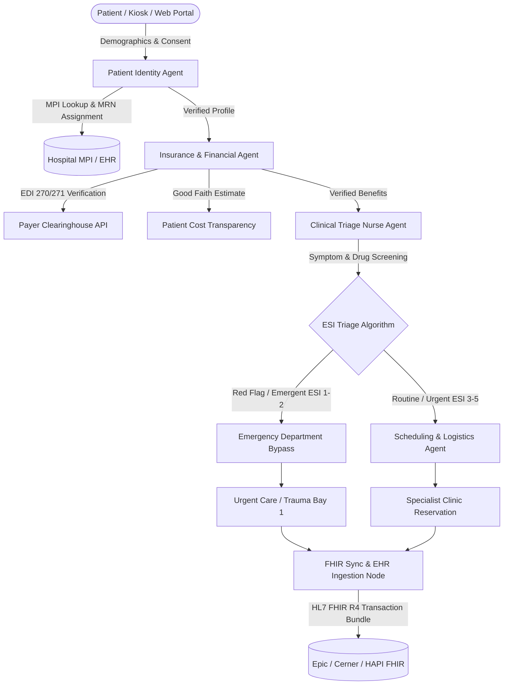

# 🏥 Hospital Patient Onboarding AI System (Powered by Google ADK)

An enterprise-grade, clinical and administrative AI agent system designed to streamline, automate, and safeguard the **Patient Onboarding and Intake Process** in hospital networks. Built entirely on the **Google Agent Development Kit (ADK 2.0)** and Google Gemini models, this system bridges the gap between patient self-service, clinical safety triage, real-time insurance verification, and EHR (Electronic Health Record) synchronization.

---

## 🌟 Executive Summary & Capabilities Architecture



The system is built upon the five core pillars requested:

### 1. 🛠️ Tool & Interface Design
- **Custom ADK FunctionTools**: Strict Pydantic validation schemas, comprehensive docstrings, and error handling:
  - `lookup_master_patient_index`: Searches hospital Master Patient Index (MPI / EHR); returns existing Medical Record Number (MRN) or generates a new one.
  - `register_patient_profile`: Enforces electronic HIPAA privacy notice acknowledgement before clinical registration.
  - `verify_insurance_eligibility`: Real-time payer eligibility verification (EDI 270/271 emulation), validating in-network status, deductible, and specialist copays.
  - `calculate_patient_cost_estimate`: Produces Good Faith Estimates compliant with the **No Surprises Act**.
  - `evaluate_clinical_acuity`: Implements the 5-level **Emergency Severity Index (ESI)** algorithm with automated life-threatening red-flag detection.
  - `check_drug_allergy_contraindications`: Screens active home medications against documented allergies to catch adverse interactions.
  - `get_available_department_slots` & `book_appointment_slot`: Queries specialty clinic schedules and locks arrival appointments.
  - `export_onboarding_to_fhir_bundle`: Assembles HL7 FHIR R4 `Patient`, `Coverage`, and `Encounter` transaction bundles.
- **Human-In-The-Loop (HITL) Guardrails**: Tool confirmation mechanics for critical commitments (e.g. financial responsibility signoff, emergency dispatch).
- **Dual Interfaces**:
  - **Interactive CLI Runner** (`src/interfaces/cli_runner.py`): Step-by-step terminal execution with sample scenarios.
  - **Production FastAPI REST Service** (`src/interfaces/api_server.py`): Full HTTP API with `/health`, `/api/v1/onboard/submit`, and `/api/v1/metrics`.

### 2. 🧠 Context & Memory
- **ADK Multi-Scope State Management**:
  - **Session Scope** (`current_step`, `intake_payload`): Scoped to the single intake interaction.
  - **User Scope** (`user:mrn`, `user:dob`, `user:allergies`, `user:primary_payer`): Durable patient clinical history that survives across future visits.
  - **App Scope** (`app:hospital_name`, `app:hospital_id`, `app:hipaa_notice_version`): Global hospital policies shared across all patients.
  - **Temp Scope** (`temp:ocr_cache`, `temp:scratchpad`): Ephemeral scratchpads scrubbed before database persistence for HIPAA minimization.
- **Longitudinal Clinical Memory** (`LongitudinalPatientMemory`): Episodic storage tracking prior hospital encounters, allergy changes, and diagnostic history.
- **Pluggable Session Persistence**: Native factory supporting `InMemorySessionService`, `SqliteSessionService`, and `FirestoreSessionService`.

### 3. 🔀 Orchestration & Logic
- **Graph-Based ADK Workflow** (`create_patient_onboarding_workflow`):
  - Deterministic execution flow with explicit node graphs: `START -> intake_node -> insurance_node -> triage_node`.
  - **Conditional Branching & Fallbacks**:
    - Emergency symptoms (e.g. chest pain, stroke signs) dynamically branch to `emergency_dispatch_node`.
    - Standard symptoms branch to `scheduling_node`.
    - Both paths join at `fhir_sync_node` for atomic hospital EHR synchronization.
- **Multi-Agent Specialist Hierarchy**:
  - `OnboardingCoordinatorAgent`: Master orchestrator delegating to specialized domain subagents:
    - `IntakeAgent`: Identity & HIPAA consent.
    - `InsuranceAgent`: Benefits & cost estimation.
    - `TriageAgent`: Clinical acuity & drug safety.
    - `SchedulingAgent`: Department routing & booking.

### 4. 🔍 Observability & Tracing
- **OpenTelemetry Distributed Tracing**:
  - Instrumentation with ADK `AutoTracingPlugin` and `LoggingPlugin`.
  - Distributed trace spans covering workflow nodes, tool executions, and LLM calls.
  - Compatible with Google Cloud Trace, Jaeger, and Datadog.
- **HIPAA PII/PHI Sanitizer** (`hipaa_sanitizer.py`):
  - Automated redaction filter masking SSNs, MRNs, phone numbers, emails, and policy IDs in logs and trace attributes before they exit the secure environment.
- **Immutable Clinical Audit Logging** (`HIPAAClinicalAuditLogger`):
  - Structured audit trail compliant with HIPAA Security Rule 164.312(b).
- **Funnel Telemetry & Metrics** (`OnboardingMetricsTracker`):
  - Real-time tracking of intake completions, drop-offs, emergency diversion counts, and department volume.

### 5. 🚀 Infrastructure & CI/CD
- **Multi-Stage Dockerfile** (`infra/Dockerfile`): Minimal, security-hardened non-root image (`appuser`) for HIPAA compliance.
- **Docker Compose Stack** (`infra/docker-compose.yml`): Full local test stack including the Onboarding Agent, HAPI FHIR R4 server, and Jaeger telemetry UI.
- **Google Cloud Run Specification** (`infra/cloudrun-service.yaml`): Cloud-native deployment manifest with VPC access connector, autoscaling (2-20 instances), and Secret Manager secrets.
- **Terraform Infrastructure as Code** (`infra/terraform/`): Automated provisioning of GCP Cloud Run, Artifact Registry, Secret Manager, Cloud Trace, and IAM roles.
- **CI/CD Automation**:
  - **GitHub Actions** (`.github/workflows/ci.yml` & `deploy.yml`): Ruff linting, MyPy type checks, Pytest execution, and container deployment.
  - **Google Cloud Build** (`infra/cloudbuild.yaml`): Container build, Trivy vulnerability scanning, and Cloud Run deployment.
- **Automated Evaluation Suite** (`evals/evalset.json` & `evals/eval_criteria.json`): Golden clinical intake test cases evaluated on Clinical Safety, Data Completeness, HIPAA Compliance, and Empathy.

---

## 📁 Repository Structure

```
patient_onboarding_adk/
├── README.md                                  # This documentation
├── pyproject.toml                             # Project metadata, dependencies, tool configs
├── requirements.txt                           # Production & dev requirements
├── .env.example                               # Environment variable templates
│
├── config/                                    # Hospital configurations & settings
│   ├── __init__.py
│   ├── settings.py                            # Pydantic BaseSettings
│   └── hospital_departments.json              # Clinic directories, slots, prep instructions
│
├── src/
│   ├── models/                                # Pydantic domain models
│   │   ├── patient.py                         # Demographics, Consent, Emergency Contact
│   │   ├── insurance.py                       # Insurance Policy, Eligibility, Coverage
│   │   ├── clinical.py                        # Triage, AcuityLevel (ESI 1-5), Allergies
│   │   ├── appointment.py                     # Clinic Departments, Booking confirmations
│   │   └── fhir.py                            # HL7 FHIR R4 Bundle schemas
│   │
│   ├── tools/                                 # 1. Tool & Interface Design
│   │   ├── identity_tools.py                  # MPI lookup & registration
│   │   ├── insurance_tools.py                 # Real-time EDI 270/271 eligibility
│   │   ├── clinical_tools.py                  # ESI triage & drug-allergy contraindication checks
│   │   ├── scheduling_tools.py                # Department slot lookup & booking
│   │   ├── fhir_tools.py                      # HL7 FHIR R4 bundle generator
│   │   └── confirmation_guard.py              # Human-in-the-Loop guardrails
│   │
│   ├── memory/                                # 2. Context & Memory
│   │   ├── state_manager.py                   # Multi-scope state (session, user, app, temp)
│   │   ├── session_service.py                 # Persistent session management (SQLite/Firestore)
│   │   └── clinical_memory.py                 # Longitudinal episodic patient memory
│   │
│   ├── agents/                                # 3. Multi-Agent Hierarchy
│   │   ├── coordinator.py                     # Root Onboarding Coordinator Agent
│   │   ├── intake_agent.py                    # Demographics & HIPAA agent
│   │   ├── insurance_agent.py                 # Payer verification agent
│   │   ├── triage_agent.py                    # Clinical acuity & nurse agent
│   │   └── scheduling_agent.py                # Logistics & slot booking agent
│   │
│   ├── workflow/                              # Graph Orchestration
│   │   ├── onboarding_workflow.py             # ADK Workflow graph & routing
│   │   └── routes.py                          # Conditional route definitions
│   │
│   ├── observability/                         # 4. Observability & Tracing
│   │   ├── tracer.py                          # OpenTelemetry & ADK AutoTracingPlugin
│   │   ├── hipaa_sanitizer.py                 # PII/PHI redaction filter
│   │   ├── audit_logger.py                    # HIPAA Security Rule audit logging
│   │   └── metrics.py                         # Intake funnel KPI metrics tracker
│   │
│   └── interfaces/                            # Interfaces
│       ├── cli_runner.py                      # Interactive CLI terminal runner
│       └── api_server.py                      # Production FastAPI REST service
│
├── tests/                                     # Automated Test Suite
│   ├── conftest.py                            # Test fixtures & mock patients
│   ├── test_tools.py                          # Unit tests for tools
│   ├── test_memory.py                         # Unit tests for state & memory
│   ├── test_workflow.py                       # Integration tests for ADK graph
│   ├── test_observability.py                  # Tests for PHI redaction & audit logger
│   └── test_evaluation.py                     # Automated evaluation against evalset.json
│
├── evals/                                     # ADK Evaluation Benchmarks
│   ├── evalset.json                           # Golden clinical test scenarios
│   └── eval_criteria.json                     # Clinical safety & HIPAA evaluation rubric
│
└── infra/                                     # 5. Infrastructure & CI/CD
    ├── Dockerfile                             # Multi-stage production container
    ├── docker-compose.yml                     # Local stack (Agent + HAPI FHIR + Jaeger)
    ├── cloudrun-service.yaml                  # Google Cloud Run deployment manifest
    ├── cloudbuild.yaml                        # Google Cloud Build pipeline
    └── terraform/                             # Cloud Infrastructure as Code (GCP)
        ├── main.tf
        ├── variables.tf
        └── outputs.tf
```

---

## ⚡ Local Deployment & Quickstart Guide

This project is pre-configured for **Local Deployment** using:
- **SQLite Session Persistence** (`/tmp/patient_onboarding_sessions.db`)
- **Local Mock HAPI FHIR R4 Integration** (`http://localhost:8081/fhir`)
- **Standard Conversational Consent** (Verbal intake verification)

### Option A: One-Click Local Runner (`scripts/run_local.sh`)
Execute the pre-configured local runner script:
```bash
cd patient_onboarding_adk
./scripts/run_local.sh 1   # Standard Outpatient Intake (CLI)
./scripts/run_local.sh 2   # Emergency Chest Pain Diversion (CLI)
./scripts/run_local.sh 3   # Start FastAPI Server (Port 8080)
./scripts/run_local.sh 4   # Run Pytest Test Suite
```

### Option B: Local Mock HAPI FHIR Server
To test real HTTP FHIR R4 ingestion without external dependencies or Docker:
```bash
python3 scripts/mock_fhir_server.py 8081
```
Or with Docker Compose:
```bash
docker compose -f infra/docker-compose.yml up hapi-fhir
```

### 1. Installation
Ensure Python 3.11+ is installed. Clone or navigate to the repository:

```bash
cd patient_onboarding_adk
pip install -r requirements.txt
```

### 2. Configure Environment
Copy `.env.example` to `.env` (pre-configured for local mode):

```bash
cp .env.example .env
```

### 3. Run Interactive CLI Demonstration
Execute the ADK CLI runner to simulate patient onboarding:

**Scenario A: Routine Outpatient Intake (Orthopedics with Conversational Consent)**
```bash
python -m src.interfaces.cli_runner --scenario standard
```

**Scenario B: Emergent Red-Flag Diversion (Acute Chest Pain -> Emergency Care)**
```bash
python -m src.interfaces.cli_runner --scenario emergency
```

### 4. Start the FastAPI REST API Server
```bash
uvicorn src.interfaces.api_server:app --host 0.0.0.0 --port 8080 --reload
```
- Interactive Swagger UI: `http://localhost:8080/docs`
- Health check probe: `http://localhost:8080/health`
- Intake metrics summary: `http://localhost:8080/api/v1/metrics`

### 5. Run the Automated Test Suite & Evaluations
```bash
pytest -v tests/
```

---

## 🗣️ Standard Conversational Consent Mechanics

Under modern hospital intake workflows, patients frequently provide consent via conversational verbal dialogue rather than rigid e-signatures:
1. **Dialogue Prompt**: The agent presents the hospital's Notice of Privacy Practices and asks:
   > *"Do you acknowledge our Notice of Privacy Practices and give verbal consent for examination and hospital care?"*
2. **Natural Language Affirmation**: The [`evaluate_conversational_consent`](src/tools/confirmation_guard.py) engine evaluates patient statements:
   - **Affirmative**: *"Yes"*, *"I agree"*, *"I consent"*, *"Sure"*, *"Proceed"*, *"Sounds good"*.
   - **Declined**: *"No"*, *"I decline"*, *"I don't consent"*, *"Stop"*.
3. **Audit Immutability**: The accepted verbal affirmation text, ISO-8601 UTC timestamp, and `consent_mode="CONVERSATIONAL_VERBAL"` are recorded into the patient's EHR profile and logged via the HIPAA Audit Logger under HIPAA Security Rule 164.312(b).

---

## 🔒 Security, HIPAA Compliance & Clinical Safety

1. **Strict PHI Redaction**: All outbound trace spans, logging statements, and metric tags pass through `redact_phi_text` and `sanitize_phi_dict`, preventing Social Security Numbers, phone numbers, and full names from entering third-party logging sinks.
2. **Deterministic Triage Safety Net**: Life-threatening clinical conditions (e.g., myocardial infarction symptoms, acute respiratory distress, acute anaphylaxis) bypass LLM generation and are deterministically routed to Emergency Care via graph edges.
3. **No Surprises Act Compliance**: Out-of-pocket cost calculations provide transparent Good Faith Estimates for insured and self-pay patients prior to treatment.
4. **HL7 FHIR Interoperability**: Generates atomic FHIR R4 Transaction Bundles ready for direct ingestion by major hospital EHR systems (Epic Systems, Oracle Cerner, Meditech).
